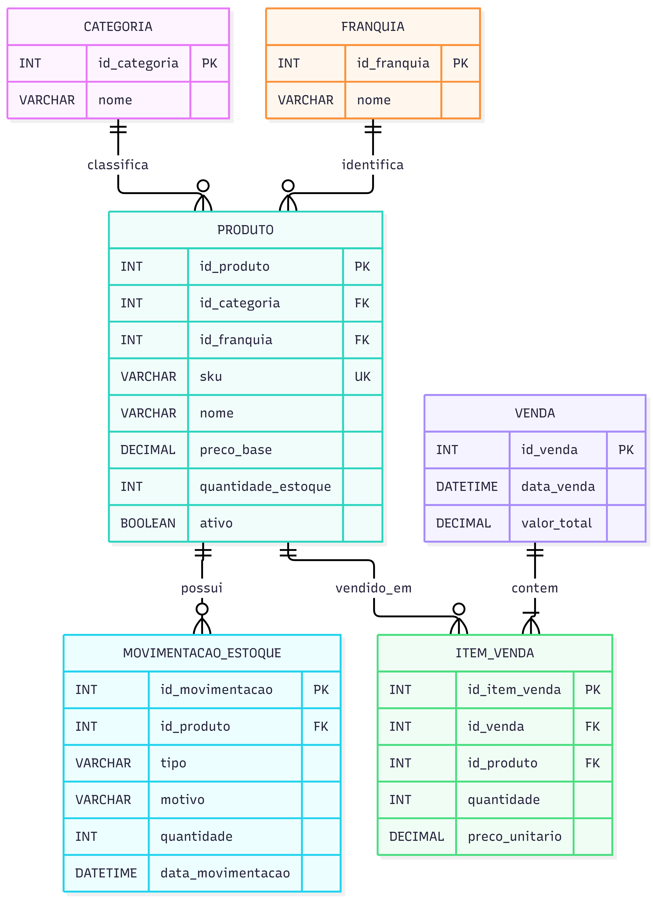

Jovem nerd, Ele quer um sistema de estoque para a loja de action figures dele.

Modelo Entidade-Relacionamento (MER) Entidades e atributos Produto: armazena o nome, o SKU, a categoria, a franquia, o preço-base e a quantidade em estoque. Categoria: organiza os produtos em Action Figure, Nendoroid e Manga. Franquia: identifica a franquia ou universo do produto, como Marvel, DC, Dragon Ball, Star Wars e Games. Venda: registra a data da venda e o valor total. Item de Venda: registra os produtos vendidos, suas quantidades e os preços unitários praticados. Movimentação de Estoque: registra as entradas e saídas de produtos, a quantidade, o tipo, o motivo e a data da movimentação. Relacionamentos Uma categoria pode classificar vários produtos (1:N). Uma franquia pode estar associada a vários produtos (1:N). Um produto pode possuir várias movimentações de estoque (1:N). Uma venda pode conter vários itens de venda (1:N). Um produto pode aparecer em vários itens de venda (1:N). Regras de negócio Cada produto deve possuir um SKU único. Ao registrar uma venda, a quantidade do produto em estoque deve diminuir automaticamente. Ao registrar uma entrada de mercadorias, a quantidade em estoque deve aumentar. As saídas devem registrar o motivo: venda, brinde ou perda/avaria. Quando restar apenas uma unidade, o sistema deve exibir a etiqueta LAST ITEM e aplicar um acréscimo de 10% no preço. A busca de produtos deve priorizar o SKU, permitindo também pesquisar por nome e franquia. O dashboard deve mostrar produtos em estoque, com baixo estoque e com estoque zerado. A interface deve possuir Dark Mode, com roxo e verde neon e estilo cyberpunk. Diagrama Entidade-Relacionamento (DER) !Diagrama DER

## Diagrama DER

